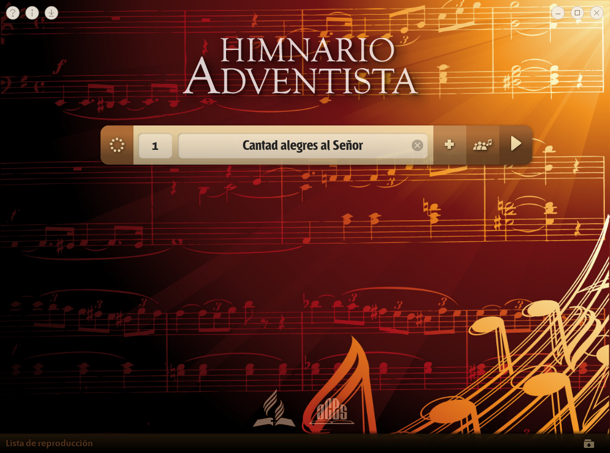

  

# Descarga el Himnario para tu equipo

Letras, música cantada e instrumental y videos para acompañar el canto en la iglesia y en casa. Elige tu edición, instala la aplicación y descarga sus recursos desde el propio Himnario.

**[Descargas](#descargas)** · **[Primer inicio](#primer-inicio)** · **[Guía de instalación](docs/GUIA.md)** · **[Ayuda](docs/AYUDA.md)**

## Descargas

**Descarga directa, sin iniciar sesión en GitHub.** Elige la fila que corresponda a tu sistema y procesador.

| Tu equipo | Descarga · versión y tamaño |
| --- | --- |
| **Windows · Intel / AMD** Windows 10 / 11 de 64 bits |**[Descargar Windows](https://github.com/supermafari007/Himnario-IASD-Actualizaciones/releases/download/v2.1.4/Himnario_Adventista_Windows_Setup.exe)** 2.1.4 · 52,9 MB · EXE |
| **Windows Legacy · Intel / AMD** XP SP3 (32 bits), Vista SP2, 7 SP1 y 8/8.1 |**[Descargar Windows Legacy](https://github.com/supermafari007/Himnario-IASD-Actualizaciones/releases/download/v2.1.4/Himnario_Adventista_Windows_Legacy_x86_Setup.exe)** 2.1.4 · 7,2 MB · EXE x86 |
| **Mac · Apple Silicon** Chip M1 o posterior · macOS 26 / 27 |**[Descargar Mac Apple Silicon](https://github.com/supermafari007/Himnario-IASD-Actualizaciones/releases/download/v2.1.4/Himnario_Adventista_macOS_AppleSilicon.dmg)** 2.1.4 · 3,2 MB · DMG |
| **Mac · Intel** Procesador Intel · macOS 26 Tahoe |**[Descargar Mac Intel](https://github.com/supermafari007/Himnario-IASD-Actualizaciones/releases/download/v2.1.4/Himnario_Adventista_macOS_Intel.dmg)** 2.1.4 · 3,2 MB · DMG |
| **Linux · Intel / AMD** Ubuntu 24.04+, Mint 22+ o Debian 13 |**[Descargar Linux Intel / AMD](https://github.com/supermafari007/Himnario-IASD-Actualizaciones/releases/download/v2.1.4/Himnario_Adventista_Linux_AMD64.deb)** 2.1.4 · 1,3 MB · DEB |
| **Linux · ARM64** Ubuntu 24.04+ o Debian 13 · ARM de 64 bits |**[Descargar Linux ARM64](https://github.com/supermafari007/Himnario-IASD-Actualizaciones/releases/download/v2.1.4/Himnario_Adventista_Linux_ARM64.deb)** 2.1.4 · 1,3 MB · DEB |

Los tamaños de esta tabla corresponden al instalador. **Los recursos se descargan después**, desde la aplicación. Windows Legacy incluye Solo letra, Instrumental y Cantado; utiliza su propio paquete de letras y música, sin videos. [Guía de Windows Legacy](docs/WINDOWS-LEGACY.md).

<strong>¿Cómo sé qué descarga necesito?</strong>

- **Windows:** abre **Configuración > Sistema > Acerca de** y revisa **Tipo de sistema**. Para Windows 10/11 elige la edición actual de 64 bits. Para XP/Vista/7/8 elige **Windows Legacy** (XP requiere SP3 de 32 bits).
- **Mac:** abre el menú **Apple > Acerca de esta Mac**. Si aparece **Chip Apple M…**, elige **Apple Silicon**; si aparece **Procesador Intel**, elige **Mac Intel**. Comprueba también la versión de macOS que indica la tabla.
- **Linux:** para un PC Intel o AMD elige **Linux Intel / AMD**. Para un equipo ARM de 64 bits elige **Linux ARM64**. Si necesitas confirmarlo, `uname -m` muestra `x86_64` para Intel/AMD o `aarch64` para ARM64.

**AMD64 sirve tanto para procesadores Intel como AMD.** Para instalar en un Mac, utiliza el archivo **DMG** de tu procesador.

<strong>¿Por qué hay un archivo llamado WebView2 en las descargas?</strong>

Para Windows 10/11 de 64 bits, descarga **Himnario_Adventista_Windows_Setup.exe**. El archivo **Himnario_Adventista_WebView2_Setup.exe** es una copia idéntica con el nombre antiguo, conservada para que las versiones anteriores puedan actualizarse automáticamente.

WebView2 es el motor de Microsoft que utiliza la aplicación para mostrar su interfaz. Ese archivo no es otra edición del Himnario ni un instalador independiente del motor WebView2.

## Primer inicio

1. **Instala y abre el Himnario.** En Windows ejecuta el EXE; en macOS abre el DMG y arrastra la app a **Aplicaciones**; en Linux abre el DEB con el instalador de software.
2. **Pulsa Descargar ahora.** Puedes usar **Elegir carpeta** para guardar las letras, la música y los videos en otro disco.
3. **Espera a que se integren los recursos.** Al terminar, pulsa **Volver al Himnario**. Ya podrás reproducir el contenido descargado sin conexión.

> **Antes de comenzar:** el paquete multimedia actual pesa **4,21 GB**. Reserva aproximadamente **8,6 GB libres** durante la descarga y la instalación. Puedes pausar y continuar la descarga desde el asistente. Windows Legacy usa un paquete separado de **3,87 GB**, con unos **8,0 GB libres** durante su instalación.

**[Instalar en Windows](docs/GUIA.md#instalar-windows)** · **[Instalar en Windows Legacy](docs/GUIA.md#instalar-windows-legacy)** · **[Instalar en macOS](docs/GUIA.md#instalar-macos)** · **[Instalar en Linux](docs/GUIA.md#instalar-linux)**

## Qué puedes hacer

- Buscar entre **613 himnos** por número o título y explorar sus temas.
- Mostrar las letras y reproducir música **cantada o instrumental**.
- Reproducir videos en los himnos que tienen ese recurso disponible, en las ediciones actuales.
- Preparar listas de reproducción y usar el modo secuencial o aleatorio.
- Usar pantalla completa, mover la ventana y ajustar su tamaño.
- Comprobar actualizaciones y reparar los recursos desde el programa.

<strong>Ver la interfaz del Himnario</strong>

Vista de la edición Linux. Las ediciones actuales comparten sus funciones; macOS utiliza sus controles de ventana nativos. Windows Legacy se centra en el himnario estándar, sin reproducción de video.

## Actualizar o reparar

Abre **Buscar actualización** dentro del Himnario. Cada edición busca el instalador correspondiente a su sistema y procesador.

Si faltan letras, música o videos, pulsa **Reparar Contenido Multimedia** en ese mismo diálogo. Se abrirá el asistente de descarga, con elección de carpeta, pausa, reanudación y reintento. Al finalizar, pulsa **Volver al Himnario**.

Las actualizaciones normales conservan tus recursos y preferencias. La reparación vuelve a instalar el contenido oficial y puede sustituir archivos multimedia personalizados.

## Ayuda para la comunidad

| Necesitas… | Encuentra aquí |
| --- | --- |
| Instalar el programa o reconocer tu procesador | [Guía de instalación](docs/GUIA.md) |
| Resolver dudas de descarga, espacio o apertura en macOS | [Preguntas frecuentes](docs/AYUDA.md) |
| Informar un problema o hacer una consulta | [Abrir una consulta](https://github.com/supermafari007/Himnario-IASD-Actualizaciones/issues/new/choose) |
| Revisar cambios y versiones anteriores | [Historial de versiones](https://github.com/supermafari007/Himnario-IASD-Actualizaciones/releases) |
| Eliminar el programa y sus recursos | [Desinstalación por sistema](docs/AYUDA.md#desinstalar) |

## Comparte el Himnario

Comparte este enlace con tu iglesia, familiares o amigos. Desde aquí podrán elegir la edición que corresponda a su equipo:

**https://github.com/supermafari007/Himnario-IASD-Actualizaciones**

---

**Adaptación y mantenimiento:** [Manuel Farías](https://github.com/supermafari007). Este repositorio reúne instaladores y documentación de distribución; el código de las aplicaciones se mantiene en repositorios privados.
