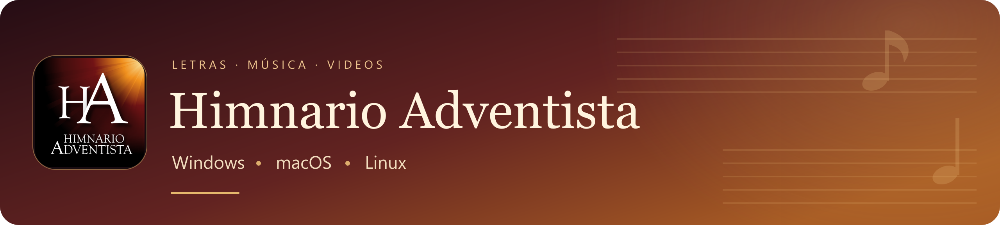

  

# Descarga el Himnario para tu equipo

**613 himnos** para acompañar el canto en la iglesia y en casa, con letras, música cantada e instrumental y videos disponibles. Elige la edición de tu equipo, instala la aplicación y descarga los recursos que necesitas desde el propio Himnario.

**[Descargas](#descargas)** · **[Funciones](#que-ofrece-el-himnario)** · **[Primer inicio](#primer-inicio)** · **[Guía de instalación](docs/GUIA.md)** · **[Ayuda](docs/AYUDA.md)**

## Qué ofrece el Himnario

| Función | Qué puedes hacer |
| --- | --- |
| **613 himnos** | Buscar por número o título y reproducir Solo letra, Instrumental o Cantado. Windows moderno, macOS y Linux incluyen también los videos disponibles; Legacy se centra en letras y música. |
| **Temas y sugerencias** | Explorar las categorías originales o escribir una necesidad, como «un himno para terminar el culto». Incluye accesos a Gratitud, Consuelo, Oración, Diezmo y Ofrendas, Bautismo, Santa Cena, Presentación de un niño, Matrimonio y Funerales, entre otros. Las sugerencias explican su relación con la letra. |
| **Favoritos y recientes** | Guardar himnos con el corazón, buscar en tus favoritos, deshacer una eliminación y respaldarlos en JSON compatible entre ediciones. Recientes registra las reproducciones de la sesión y se borra al cerrar. |
| **Listas de reproducción** | Preparar una lista, ordenar sus himnos, guardarla para otra ocasión y reproducirla de forma secuencial o aleatoria. El signo **+** permite añadir desde favoritos, recientes y sugerencias sin iniciar la reproducción. |
| **Una o dos pantallas** | Usar el Himnario normalmente con una pantalla, o mantener el menú en la principal y enviar la reproducción a una TV, monitor o proyector. La secundaria espera con una portada; sus controles permiten navegar, ocultar las letras sin detener el audio y minimizar cada ventana por separado. |
| **Recursos a tu medida** | Descargar, actualizar o reparar solo Letras, Cantado, Instrumental o Video, según tu edición. Elegir carpeta, pausar y continuar las descargas. Reconocer una biblioteca anterior y renovar solo las letras a **Letras 2.0**. |
| **Ayuda y actualizaciones** | Recorrer una guía visual con el botón **?**, usar pantalla completa o ventana y comprobar nuevas versiones desde el programa. Cada edición recibe el instalador de su sistema y procesador. |

**Una vez descargados los recursos, puedes utilizar el Himnario sin conexión.** Las actualizaciones normales conservan tu biblioteca, favoritos y preferencias. Las descargas de este repositorio no requieren iniciar sesión en GitHub.

## Versión 2.1.9 · Windows, macOS y Linux

La **2.1.9 está disponible para todas las ediciones**: Windows 10/11, Windows Legacy, macOS Intel y Apple Silicon, y Linux AMD64/ARM64. Esta actualización mejora el manejo de la presentación, la respuesta de la interfaz y la ayuda visual. Conserva la biblioteca multimedia, los favoritos y las preferencias existentes.

### Novedades de la 2.1.9

- **Panel de presentación fijo:** consulta el himno que se está reproduciendo y avanza, retrocede o detén la reproducción mientras preparas el siguiente desde el menú.
- **Ocultar letra:** deja la portada de espera en la pantalla secundaria y mantiene el audio. La elección se conserva al cambiar de himno durante la sesión; pulsa de nuevo el ojo para mostrar las letras. Al volver a abrir, empiezan visibles.
- **Minimización independiente:** minimiza el menú o la pantalla secundaria por separado y recupera la presentación desde su control.
- **Pantallas en caliente:** conecta o desconecta otra pantalla sin reiniciar. Con una sola pantalla se conserva el funcionamiento habitual.
- **Iconos y ayuda renovados:** modos de reproducción e indicaciones de la guía ajustados a los controles actuales de cada sistema.

Con salidas duplicadas, se intenta una **ampliación temporal** cuando el sistema y el controlador lo permiten. Al cerrar se recupera la distribución anterior si las pantallas siguen conectadas y no la has cambiado. En XP/Vista configura Extender desde Windows; en Linux, la ampliación automática se prepara para GNOME/Zorin y X11, y otros escritorios o configuraciones especiales utilizan sus ajustes de pantalla.

**Windows Legacy** conserva Solo letra, Instrumental y Cantado. Las demás ediciones incluyen también los videos disponibles. [Consulta las notas completas de la 2.1.9](docs/NOTAS-2.1.9.md).

## Descargas

**Descarga directa, sin iniciar sesión en GitHub.** Elige la fila que corresponda a tu sistema y procesador.

| Tu equipo | Descarga · versión y tamaño |
| --- | --- |
| **Windows · Intel / AMD** Windows 10 / 11 de 64 bits |**[Descargar Windows](https://github.com/supermafari007/Himnario-IASD-Actualizaciones/releases/download/v2.1.9/Himnario_Adventista_Windows_Setup.exe)** 2.1.9 · 54,9 MB · EXE |
| **Windows Legacy · Intel / AMD** XP SP3 (32 bits), Vista SP2, 7 SP1 y 8/8.1 |**[Descargar Windows Legacy](https://github.com/supermafari007/Himnario-IASD-Actualizaciones/releases/download/v2.1.9/Himnario_Adventista_Windows_Legacy_x86_Setup.exe)** 2.1.9 · 9,1 MB · EXE x86 |
| **Mac · Apple Silicon** Chip M1 o posterior · Tahoe, Golden Gate y posteriores |**[Descargar Mac Apple Silicon](https://github.com/supermafari007/Himnario-IASD-Actualizaciones/releases/download/v2.1.9/Himnario_Adventista_macOS_AppleSilicon.dmg)** 2.1.9 · 6,2 MB · DMG |
| **Mac · Intel** Procesador Intel · Ventura, Sonoma, Sequoia y Tahoe |**[Descargar Mac Intel](https://github.com/supermafari007/Himnario-IASD-Actualizaciones/releases/download/v2.1.9/Himnario_Adventista_macOS_Intel.dmg)** 2.1.9 · 6,3 MB · DMG |
| **Linux · Intel / AMD** Ubuntu 24.04+, Mint 22+, Zorin OS 18 o Debian 13 |**[Descargar Linux Intel / AMD](https://github.com/supermafari007/Himnario-IASD-Actualizaciones/releases/download/v2.1.9/Himnario_Adventista_Linux_AMD64.deb)** 2.1.9 · 3,0 MB · DEB |
| **Linux · ARM64** Ubuntu 24.04+ o Debian 13 · ARM de 64 bits |**[Descargar Linux ARM64](https://github.com/supermafari007/Himnario-IASD-Actualizaciones/releases/download/v2.1.9/Himnario_Adventista_Linux_ARM64.deb)** 2.1.9 · 3,0 MB · DEB |

### Compatibilidad con macOS

- **Intel:** macOS Ventura, Sonoma, Sequoia y Tahoe.
- **Apple Silicon (M1 o posterior):** desde macOS Tahoe, incluido Golden Gate y versiones posteriores compatibles con tu Mac.

Elige el **DMG de tu procesador** y arrastra el Himnario a **Aplicaciones**.

Los tamaños de esta tabla corresponden al instalador. **Los recursos se descargan después**, desde la aplicación. Windows Legacy incluye Solo letra, Instrumental y Cantado; descarga letras y música por componentes, sin videos. [Guía de Windows Legacy](docs/WINDOWS-LEGACY.md).

<strong>¿Cómo sé qué descarga necesito?</strong>

- **Windows:** abre **Configuración > Sistema > Acerca de** y revisa **Tipo de sistema**. Para Windows 10/11 elige la edición actual de 64 bits. Para XP/Vista/7/8 elige **Windows Legacy** (XP requiere SP3 de 32 bits).
- **Mac:** abre el menú **Apple > Acerca de esta Mac**. Si aparece **Chip Apple M…**, elige **Apple Silicon**; si aparece **Procesador Intel**, elige **Mac Intel**. Comprueba también la versión de macOS que indica la tabla.
- **Linux:** para un PC Intel o AMD elige **Linux Intel / AMD**. Para un equipo ARM de 64 bits elige **Linux ARM64**. Si necesitas confirmarlo, `uname -m` muestra `x86_64` para Intel/AMD o `aarch64` para ARM64.

**AMD64 sirve tanto para procesadores Intel como AMD.** Para instalar en un Mac, utiliza el archivo **DMG** de tu procesador.

<strong>¿Cuál es el instalador de Windows?</strong>

Para Windows 10/11 de 64 bits, descarga **Himnario_Adventista_Windows_Setup.exe**. Desde la versión 2.1.6 este es el único instalador de Windows moderno. El nombre antiguo queda limitado a publicaciones anteriores.

WebView2 es el motor de Microsoft que utiliza la aplicación para mostrar su interfaz. Ese archivo no es otra edición del Himnario ni un instalador independiente del motor WebView2.

## Primer inicio

1. **Instala y abre el Himnario.** En Windows ejecuta el EXE; en macOS abre el DMG y arrastra la app a **Aplicaciones**; en Linux abre el DEB con el instalador de software.
2. **Descarga los recursos que necesitas.** En el asistente elige los componentes que necesitas y pulsa **Descargar ahora**. Puedes usar **Elegir carpeta** para guardarlos en otro disco.
3. **Espera a que se integren los recursos.** Al terminar, pulsa **Volver al Himnario**. Ya podrás reproducir el contenido descargado sin conexión.

> **Todas las ediciones actuales:** el asistente muestra el tamaño de los componentes seleccionados y comprueba el espacio necesario. Letras 2.0 se descarga en dos partes y se instala como un solo componente; puedes conservar la música y los videos que ya tienes.
>
> **Windows Legacy:** ofrece Letras, Cantado e Instrumental. Las demás ediciones añaden Video. El asistente indica el espacio necesario según la selección; puedes conservar la biblioteca anterior y actualizar solo Letras.

**[Instalar en Windows](docs/GUIA.md#instalar-windows)** · **[Instalar en Windows Legacy](docs/GUIA.md#instalar-windows-legacy)** · **[Instalar en macOS](docs/GUIA.md#instalar-macos)** · **[Instalar en Linux](docs/GUIA.md#instalar-linux)**

<strong>Ver la interfaz del Himnario</strong>

Vista de una edición anterior de Linux. Las ediciones actuales incluyen favoritos, recientes, temas y sugerencias, segunda pantalla y la nueva guía de ayuda. macOS utiliza sus controles de ventana nativos. Windows Legacy se centra en el himnario estándar, sin reproducción de video.

## Actualizar o reparar

Abre **Buscar actualización** dentro del Himnario. Cada edición busca el instalador correspondiente a su sistema y procesador.

Si faltan letras, música o videos, pulsa **Reparar Contenido Multimedia** en ese mismo diálogo. Se abrirá el asistente de descarga, con elección de carpeta, pausa, reanudación y reintento. Al finalizar, pulsa **Volver al Himnario**.

**En todas las ediciones actuales**, el asistente permite marcar solo los componentes que deseas descargar o reparar. Letras 2.0 se verifica e instala desde sus dos partes sin volver a descargar la música. La biblioteca procedente del paquete completo anterior se conserva y sigue funcionando.

Las actualizaciones normales conservan tus recursos y preferencias. La reparación vuelve a instalar el contenido oficial y puede sustituir archivos multimedia personalizados.

## Ayuda para la comunidad

| Necesitas… | Encuentra aquí |
| --- | --- |
| Instalar el programa o reconocer tu procesador | [Guía de instalación](docs/GUIA.md) |
| Resolver dudas de descarga, espacio o apertura en macOS | [Preguntas frecuentes](docs/AYUDA.md) |
| Informar un problema o hacer una consulta | [Abrir una consulta](https://github.com/supermafari007/Himnario-IASD-Actualizaciones/issues/new/choose) |
| Revisar cambios y versiones anteriores | [Historial de versiones](https://github.com/supermafari007/Himnario-IASD-Actualizaciones/releases) |
| Eliminar el programa y sus recursos | [Desinstalación por sistema](docs/AYUDA.md#desinstalar) |

## Comparte el Himnario

Comparte este enlace con tu iglesia, familiares o amigos. Desde aquí podrán elegir la edición que corresponda a su equipo:

**https://github.com/supermafari007/Himnario-IASD-Actualizaciones**

---

**Adaptación y mantenimiento:** [Manuel Farías](https://github.com/supermafari007). Este repositorio reúne instaladores y documentación de distribución; el código de las aplicaciones se mantiene en repositorios privados.
